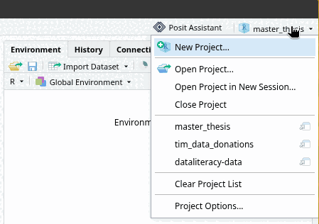
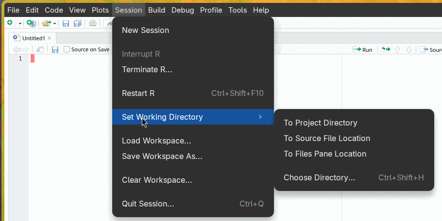

R is distributed through [CRAN (the Comprehensive R Archive Network)](https://cran.r-project.org/). Do not be alarmed by the website's 90's aesthetics. The website is legit.
At the top of the page, choose the link for your operating system
::: {.panel-tabset}

## Windows

1. Click **Download R for Windows**.
2. Click **base** (or **install R for the first time**).
3. Click the big **Download R-4.x.x for Windows** link at the top (the exact version number will differ).
4. Open the downloaded `.exe` file and follow the installer. You can keep all the default options, so just keep clicking **Next**.

You might see a link to **Rtools** on the CRAN website. You do *not* need this for this course.

## macOS

1. Click **Download R for macOS**.
2. Pick the right installer for your type of Mac. There are two versions, and you need the one that matches your processor:
   * **Apple silicon** (M1, M2, M3, etc.): download the file ending in **`arm64.pkg`**.
   * **Intel**: download the file ending in **`x86_64.pkg`**.

   Not sure which one you have? Click the Apple menu (the Apple logo) in the top-left corner of your screen and choose **About This Mac**. If it says **Chip: Apple M...**, you have Apple silicon. If it says **Processor: ... Intel ...**, you have an Intel Mac.
3. Open the downloaded `.pkg` file and follow the installer, keeping the default options.

## Linux

R is available through the package manager of most Linux distributions, but the version there is often outdated.
On the CRAN website, click **Download R for Linux** and pick your distribution (e.g., Ubuntu, Debian, Fedora) for instructions on how to install the latest version.

:::

### Step 2: Install RStudio

RStudio is made by a company called Posit. Go to the [RStudio Desktop download page](https://posit.co/download/rstudio-desktop) on the Posit website.
The page also tells you to install R (step 1 on their page), but you have already done that, so you can skip to **Install RStudio**.

* The website will usually detect your operating system and show a download button for it. If not, scroll down to the table with all installers and pick the one for your system.
* **Windows**: open the downloaded `.exe` file and follow the installer, keeping the default options.
* **macOS**: open the downloaded `.dmg` file and **drag the RStudio icon into the Applications folder**. Afterwards, you can find RStudio in your Applications folder or via Spotlight (Command + Space, then type "RStudio").

### Step 3: Check that everything works

Now open **RStudio** (not R!). After installing, you will have both an *R* and an *RStudio* program on your computer, which is confusing. From now on, you only ever need to open RStudio, which will start R for you.

If everything went well, RStudio opens with a window called the **Console**, which starts with a message like this:

```
R version 4.x.x (20xx-xx-xx) -- "Some Funny Name"
Copyright (C) 20xx The R Foundation for Statistical Computing
...
```

To make sure R actually works, click in the console, type `1 + 1` and press **Enter**. If R answers with `[1] 2`, you're all set!

::: {.callout-warning title="Troubleshooting" collapse="true"}
* **RStudio says it cannot find R, or asks you to choose an R installation.** This usually means R was not installed (correctly), or RStudio was installed before R. Install R (step 1), and then restart RStudio. If that doesn't help, reinstall RStudio as well.
* **On a Mac, you downloaded the wrong R installer.** If you installed the Intel (`x86_64`) version on an Apple silicon Mac, R will still work but it is slower, and some packages can cause problems. Just download and install the `arm64` version, it will replace the old one.
* **You are on a work or university computer and are not allowed to install software.** Ask your IT department, or use one of the alternatives below.
* **Your computer cannot run R at all** (e.g., a Chromebook or tablet). You can use [Posit Cloud](https://posit.cloud), which runs RStudio in your web browser. You need to create a (free) account. The free plan has limited computing hours, so we recommend using it only if installing R on your own computer is not possible.
:::

## A first look at RStudio

The first time you open RStudio, you will see three panels. The first thing you want to do is **open an R Script** to work in. To do so, go to the menu bar and select **File -\> New File -\> R Script**.

You will now see four panels split evenly over the four corners of your screen:

-   In the **top-left** you have the text editor for the file that you are working in. This will most of the time be an R script or RMarkdown file.
-   In the **top-right** you can see the data and values that you are currently working with (environment) or view your history of input.
-   In the **bottom-left** you have the console, which is where you can enter and run code, and view the output. If you run code from your R script, it will also be executed in this console.
-   In the **bottom-right** you can browse through files on your computer, view help for functions, or view visualizations.

While you can directly enter code into your console (bottom-left), you should always work with R scripts (top-left). This allows you to keep track of what you are doing and save every step.

## Using RStudio

Open a script (**File -> New File -> R Script**) and copy/paste the following code into it.
Do not worry about understanding the code itself yet.

```{r running-code-from-the-r-script-1, eval=F}
## Lines starting with # are comments. Nothing happens if you run them

## Some simple mathematical operations
3 + 3
2 * 5
6 / 2

## A function: takes some input and gives back a result. This one calculate the sum
sum(5, 30, 18)

## Make a histogram of 30 random numbers drawn from a normal distribution
hist(rnorm(30))

## Visualize some data
plot(AirPassengers, xlab = "Year", ylab = "passengers x 1000", main = "Monthly airline passengers")
```

You can **run** code by selecting the code and clicking on the **Run** button in the toolbar.
However, we highly recommend getting used to the keyboard shortcut, because it will save you a lot of time
On Windows (and Linux) the shortcut is **Ctrl + Enter**. On Mac it's **Command + Enter**.

There are two ways to run code:

- If you select a piece of code (so that it is highlighted) you can run the entire selection. This can be a single line of code, multiple lines of code, or a selection within a line.
- If your cursor is on a line of code, and you haven't made a selection, you can run the entire line, and the cursor will automatically move to the next line. This allows you to *walk* through your code, running it line by line.

Try the following:

* Select all three lines of mathematical operations and run them. You should see the results appear in the bottom-left window (the console).
* Put your cursor on the line `3 + 3` without selecting anything. Hit **Ctrl/Command + Enter** three times (slowly). You should see the same results, but one line at a time.
* Select the line `hist(rnorm(30))` and run it. You should see a histogram appear in the bottom-right window.
* Select only the part `rnorm(30)` and run it. You should see 30 random numbers appear in the console.
* Run the line `plot(AirPassengers) ...`. You should see a plot appear in the bottom-right window.

At its simplest, this is all R is: a (very capable) calculator.
But in the next section you'll see how we can do much more by giving names to things.

## Names and objects

### Why bother naming things?

Before we get into the syntax, here's a preview of why naming things actually matters. The code below downloads a real survey dataset from the internet — the same one you'll be using throughout this book — and plots how much people trusted journalists before versus after watching a short film about journalism:

```{r why-bother-naming-things-1}
d <- read.csv("https://dev.dataliteracy.cc/practice_data.csv")
plot(d$trust_t1, d$trust_t2)
```

Don't worry about understanding every part of this yet — you'll learn exactly how to read in and work with data like this in the next two chapters. For now, just notice what happened: we downloaded an entire dataset of 600 survey respondents, gave it the name `d`, and then reused that name a line later to pull out two of its columns (`d$trust_t1` and `d$trust_t2`) and plot them against each other. None of that would be possible without naming it first. That is the heart of what makes programming powerful: once something has a name, you can reuse it, inspect it, and build on it step by step, instead of trying to cram an entire analysis into one giant, unreadable line of code.

### Assigning objects to names

In R, and in computer programming in general, the most essential operation is to assign **objects** to **names**.
By **object**, we then broadly mean any piece of information. a single number, a text, a list of numbers, and even an entire data set.

In plain terms, **assignment** is how you make R remember things by assigning them to a name. To assign an object to a name, we use the **arrow notation**: `name <- value`. For example:

```{r the-power-of-assignment-1}
x <- 2
```

::: {.callout-note title="Good to know: you can also use `x = 2`" collapse="true"}
Instead of using the **arrow** notation, you can also use the **equal sign** notation: `name = object`.

```{r the-power-of-assignment-2}
x = 2
```

We will in general always use the **arrow** notation. But if you encounter the **equal sign** notation, just remember that it's the same thing.
:::

By **running** the code `x <- 2`, you are saying: **Assign the value `2` to the name `x`**.
Any objects that you assigned to names are stored in your **Environment**. You can see this environment in the top-right window, under the **Environment** tab.
If you assigned `2` to `x`, you should see a table with in the left column the names (`x`) and in the right column a description of the object.
For simply objects like numbers, this will just be the value (`2`).

From hereon, when you use the name `x` in your code, it will **refer** to the value `2`. So when we run the code `x * 5` (x times 5) it will print the number `10`

```{r the-power-of-assignment-3}
x * 5
```

::: {.callout-note title="Why does R print a [1] before the result?" collapse="true"}
When running `x * 5`, R correctly prints the value 10. But why does it say `[1] 10`?
The reason is that R always thinks of a number (or string) as a **vector** (i.e. list of values), that can have 1 or multiple values.
The `[1]` indicates that 10 is the first (and only) value.

If you print a longer **vector**, you can see that R prints `[...]` at the start of each line, just to help you see the position of individual values.
The following code generates a vector with numbers from 1 to 50

```{r the-power-of-assignment-4}
1:50
```
:::


### Assigning results to names

Assigning values to names is usefull, but the real power of assignment is that you can also assign **results** to names.
This is what you also saw in the example above, where we used `read.csv` to download data from the internet,
and assign the result to the name `d`.

This is possible for any type of result. Here is a simple example.

```{r assigning-results-1}
x <- 5 + 10
```

What makes this so powerfull is that we can now break down any complicated procedure into multiple steps.
We can download a dataset and name it `d`.
We can then clean this dataset, and either overwrite the name `d` with the cleaned version, or create a new dataset called `d_clean`.
Next, we can perform an analysis, and store the results in a new name.
We can then use the results to create an APA table, create a visualization, and so on.

### Assigning versus printing

Notice that when you ran the code `x <- 5 + 10`, R didn't print the result (`15`) to the console.
When you assign a result to a name, you do not need to print it, because you have now stored it.
If you do want to see the value, you can always do so by next running the name `x`.

So there are three common ways to run code in R:

```{r}
## If you just want to see the result, do not assign it to a name
5 + 10

## If you want to store the result, assign it to a name
x <- 5 + 10

## If you then also want to see the result, just run the name
x
```


## Keeping track of your data {#file-management}

Recall from [Basic Computer Skills](1.01-basic-computer-skills.qmd#the-file-system) that every file on your
computer has a unique **path**.
To read and write files in R, you need to give it either an **absolute path** or a **relative path** to a file.
We explained that using a relative path is usually easier and better.
If you are not familiar with the difference between absolute and relative paths, please review those sections first.

In order to use relative paths, you need to know your **working directory**, and be able to set it
to the folder where you are working. In this section we show two approaches:

* Recommended: use RStudio projects
* Set the working directory manually

### Create an RStudio project

The easiest way to manage your data well is to create an RStudio `Project` in a folder.
This will automatically set your working directory to that folder, and if you switch between projets,
RStudio will automatically switch the working directory for you as well.

In the top-right corner of RStudio, you can see your current project name, or `Project: (None)` if you are not currently working in a project.
If you click on it, you can create a new project or open an existing project.
You can also see and switch between your recent projects (e.g., `master_thesis`, `dataliteracy-data`).

{width="45%"}

When you create a new project, you can choose to create a new directory, or use an existing directory.
Simply give it a name, and you're good to go!

You can double check your current working directory with `getwd()`.

```{r, eval=F}
getwd()
```
```{r, echo=F}
print('/Users/Chris/Projects/master_thesis')
```

### Manually setting the working directory

You can manually set your working directory with `setwd()`,
In this case you do have to figure out the absolute path yourself.

```{r, eval=F}
setwd("/Users/Chris/Projects/master_thesis")
```


Luckily, RStudio can also do this for you.
In the menu bar, click `Session -> Set Working Directory -> Choose Directory`.
This will open a file explorer, and RStudio will run `setwd()` for the folder you select.

{width="60%"}
